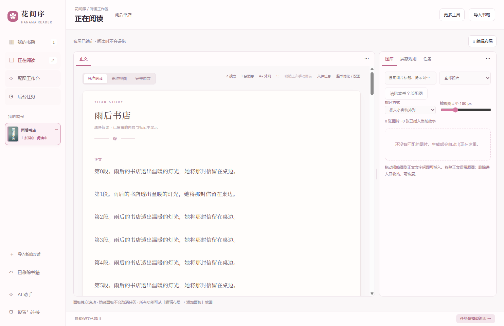

# 花间序 · Hanama Reader

一个 Windows 桌面小说与酒馆对话阅读器。整理文字、保存阅读位置，将 AI 插画放回故事，也可以自由组合阅读、图库与提示词面板。

[GitHub 仓库](https://github.com/zxy12138/hanama-reader) · [问题反馈](https://github.com/zxy12138/hanama-reader/issues)



## 文档入口

- **[完整图文使用教程](docs/USER_GUIDE.zh-CN.md)**：安装、模型设置、导入合并、规则、搜索书签、整书配图、图库重绘、角色服装、封面、布局、助手、导出与故障排查。
- **[GitHub 下载、反馈、贡献与发布教程](docs/GITHUB_GUIDE.zh-CN.md)**：第一次用 GitHub 也能逐步操作。
- [隐私与备份](docs/PRIVACY.md) · [贡献指南](CONTRIBUTING.md) · [安全报告](SECURITY.md) · [第三方与素材说明](THIRD_PARTY_NOTICES.md)

## 主要能力

| 阅读整理 | AI 与工作区 |
| --- | --- |
| TXT / JSONL / JSON 导入、编码预览、多文件合并 | OpenAI 兼容在线服务、本地推理服务连接 |
| 每本书独立规则、通用规则、选文屏蔽与恢复 | NovelAI 绘图、参数与余额检查 |
| 纯净阅读 / 整理视图 / 完整原文 | 整书分段配图、暂停、重试、保存进度 |
| 搜索、书签、阅读位置与显示设置 | 角色、服装、画风、提示词编辑与重绘 |
| 去重检查、书架移除与恢复、书本封面 | 图库拖动插入、正文定位、可组合及独立面板 |
| 文字与图片导出为单文件 HTML | 本地标签检索、授权文件夹中的 AI 助手 |

## 快速启动

需要 Node.js **>=22.13**、完整的 Electron **44.4.5 / Windows x64**。优先复用已有运行时，本项目不自动下载、不需要额外 npm 依赖。

在解压后的源码目录打开 PowerShell，替换下面的示例路径：

```powershell
$env:HANAMA_ELECTRON_PATH = 'D:\Tools\electron-44.4.5\electron.exe'
npm run runtime:check
npm start
```

不要只复制 electron.exe；运行时的其余文件也需要保留。启动器还会查找项目同级 `_shared/runtimes/electron/44.4.5/win32-x64` 和项目内 `node_modules/electron/dist`。缺少运行时只提示错误，不联网下载；手动获取渠道见教程。

首次使用：导入书籍 → 设置与连接 → 检测文字模型及 NovelAI → 小范围试画 → 再开始整书任务。普通阅读不需要 API Key。

助手文件夹默认显示“尚未授权”，不会自动授权程序目录。需要文件功能时主动选择文件夹；“清除授权”只撤销访问，不删除文件，重启后仍保持未授权。旧版已保存的授权可在设置中手动清除。

## 数据与限制

源码不包含账号、密钥、小说、模型包、词库数据库和运行时。软件数据通常保存于 Windows `%APPDATA%\hanama-reader`；独立词库和助手文件夹另行保存，更新前请备份。

在线 AI 任务会将所需文本、提示词或参考图发送至你配置的服务，可能产生费用。模型识别、去重建议与角色一致性需要核对，不能保证零误差。结果不明的绘图不要直接连续重试。

当前提供源码版本：正式安装器、EPUB/PDF 导出尚未提供。本地 GGUF 依赖已有推理引擎，不在阅读器内部直接推理。教程截图来自虚构测试资料。

## 开发与发布检查

```powershell
npm test
npm run release:prepare
```

测试使用隔离目录和模拟接口。准备命令生成新的 `dist/source-candidate-*` 白名单目录；**只上传经检查的候选目录，不上传整个日常开发工作区**。进入候选目录再执行：

```powershell
npm run release:verify
```

检查报告与 SHA-256 文件清单随候选保存。修改文件后须重新生成候选；自动扫描不替代人工审核截图与素材权利。发布步骤见 GitHub 教程。

## 许可证

代码使用 [MIT](LICENSE)。外部服务、模型、数据集和素材适用各自授权。应用现有图像及参考来源的分发权利核对状态见 [第三方说明](THIRD_PARTY_NOTICES.md)。
