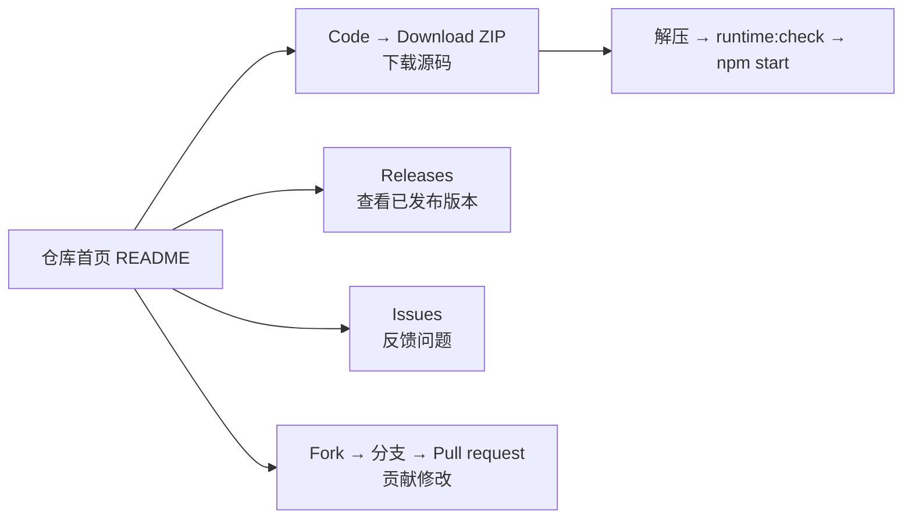
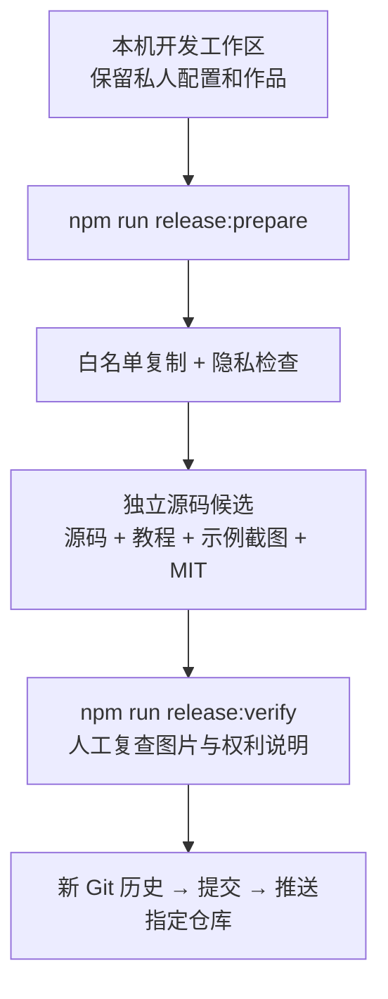

# GitHub 下载、反馈、贡献与发布教程

[返回首页](../README.md) · [软件图文教程](USER_GUIDE.zh-CN.md)

本项目仓库：[zxy12138/hanama-reader](https://github.com/zxy12138/hanama-reader)。下载本项目时，下面的 `OWNER/REPOSITORY` 对应 `zxy12138/hanama-reader`。

此文的 `OWNER`、`REPOSITORY`、路径和显示名都是占位符，需要替换。以你正在查看的仓库地址为准；源码下载不代表包含桌面安装器。

## 第一次用 GitHub：先认清入口



上图是操作路线图；软件实际界面截图在[使用教程](USER_GUIDE.zh-CN.md)。GitHub 按钮一般使用英文，README 文档可直接在网页阅读。Star 是收藏/关注项目，不会安装软件；Fork 是复制一份仓库到自己的账号，不是升级程序。

## 普通用户：下载与启动

1. 打开项目的真实 GitHub 仓库地址，先看 README 中支持的平台、启动方式和已知限制。
2. 若 Releases 有维护者提供的安装包，先阅读该版本说明并核对文件。只有 Source code ZIP 时，它是源码，不是安装器。
3. 下载当前源码可选 **Code → Download ZIP**；下载历史版本可在 Releases/Tags 选择对应版本。ZIP 不包含 Git 历史。[GitHub 源码归档说明](https://docs.github.com/en/repositories/working-with-files/using-files/downloading-source-code-archives)
4. 解压到普通可写目录，不要在 ZIP 预览里直接运行。按[首次启动教程](USER_GUIDE.zh-CN.md#安装与首次启动)配置已有 Electron，再启动。
5. 自己填写模型与绘图服务凭据。开源软件不附带别人的 API Key 或付费服务余额。助手目录初始为“尚未授权”，需要时选择自己的文件夹；不要为了启动复制别人的 settings.json。

如果习惯 Git，可以克隆后启动：

```powershell
git clone https://github.com/OWNER/REPOSITORY.git
Set-Location REPOSITORY
$env:HANAMA_ELECTRON_PATH = 'D:\Tools\electron-44.4.5\electron.exe'
npm run runtime:check
npm start
```

更新前正常关闭应用并备份数据。ZIP 用户解压新版本到新目录，继续复用运行时；Git 用户先 `git status`，确认自己的修改已处理，再 `git pull --ff-only`。不要用强制重置解决不理解的冲突，也不要删除用户数据来“升级”。旧版已保存的助手目录会保留；需要撤销时到设置点击“清除授权”，不影响目录文件。

## 出问题：怎样提交 Issue

先在 Issues 搜索是否已有相同问题，再用 Bug report 模板创建。写清：软件版本、Windows 版本、在线/本地引擎、模型名称、操作步骤、预期和实际结果、脱敏后的错误文本。尽量用三五段虚构文本复现，说明是否正在运行整书任务。

截图先裁掉账号、密钥、个人目录、小说正文、提示词或余额等不想公开的部分。不要上传配置、数据库、整本小说、聊天记录、内存快照或完整网络抓包。即使内容位于折叠区，也会公开给别人。

功能建议说明“想完成什么、现在在哪一步麻烦”，不要只写“不能用”。Discussions 只有仓库启用时才可使用。发现凭据泄漏或安全问题，不要发公开 Issue，见 [SECURITY.md](../SECURITY.md)。

## 开发者：Fork 与 Pull request

1. Fork 项目到自己的账号，克隆自己的 Fork。
2. 新建分支，例如 `git switch -c fix/gallery-position`。
3. 按 [贡献指南](../CONTRIBUTING.md)修改和测试，保留已有用户数据。
4. 提交前看 `git status`、`git diff` 与 `git diff --cached`，确认没有私人文件。不要提交模型、运行时、依赖目录或测试产生的数据。
5. 推送自己的分支，在 GitHub 创建 Pull request，描述触发条件、改动和测试结果。遵循项目 MIT 许可证，保留第三方署名。

本项目使用 Node 内置测试与现有 Electron。完整测试运行 `npm test`；只改文档时先检查图片、相对链接与发布校验即可，不需要真实调用付费 API。

## 项目所有者：第一次公开上传

**仅使用 `release:prepare` 产生并通过检查的新目录，不能把日常开发工作区整体上传。** 开发区可能包含忽略文件、聊天记录、真实作品和本机脚本；`.gitignore` 也不能清理已经被 Git 跟踪的文件或旧历史。



### 1. 生成和验收

在开发工作区执行 `npm run release:prepare`，记录它输出的候选目录。进入那个目录执行 `npm run release:verify`，应得到 `ok: true`。再查看 README、教程截图、SOURCE_AUDIT.json、SOURCE_MANIFEST.json 和 RELEASE_CHECKLIST.md。

自动扫描不是绝对保密证明，人工仍需检查业务信息和素材来源。任何文件修改后原哈希清单会失效；应回到开发工作区更新并重新生成，不要为了通过校验手改哈希。

### 2. 建立空远程仓库

登录自己的 GitHub，在 New repository 中填写名称和说明，选择可见性。准备好公开后可选 Public；尚需审查时先 Private。这里将推送已含 README、LICENSE 的本地源码，远程应建为空仓库，不再勾选初始化 README/许可证，以避免两套初始提交。[GitHub 创建仓库说明](https://docs.github.com/en/repositories/creating-and-managing-repositories/quickstart-for-repositories)

### 3. 从干净目录提交

下面命令中的目录、仓库地址与提交身份都要改成自己的。提交邮箱会进入 Git 历史；希望隐藏真实邮箱时，在 GitHub 邮箱设置中获取自己的 **noreply 地址**，不要照抄别人或示例地址。

```powershell
Set-Location 'D:\Publish\hanama-reader'
npm run release:verify
git init -b main
git config user.name 'YOUR_PUBLIC_NAME'
git config user.email 'YOUR_NOREPLY_EMAIL'
git add .
git status --short
git diff --cached --stat
git diff --cached
```

仅在上面的目录确实是干净候选且审查无误后，继续：

```powershell
git commit -m "Initial public source with Chinese guides"
git remote add origin https://github.com/OWNER/REPOSITORY.git
git remote -v
git push -u origin main
```

使用 Git 凭据管理器或 SSH 完成认证，不把 Token 填进远程 URL、命令记录或源码。如果远程已有内容而推送被拒绝，先检查，不要直接 force push。官方导入流程强调先准备本地仓库再添加远程并推送。[添加本地源码到 GitHub](https://docs.github.com/en/migrations/importing-source-code/using-the-command-line-to-import-source-code/adding-locally-hosted-code-to-github)

### 4. 上传后复查

打开仓库首页，检查 README 图片、教程跳转、LICENSE、文件列表及提交作者信息。用新的临时目录下载一次源码，验证 `runtime:check` 和启动流程。仓库里应没有 settings/story、数据库、缓存、个人脚本、模型或小说。教程图片应全是虚构示例。

后续发布版本时，可创建 Git tag 和 Release，写明变更、兼容性、迁移步骤及验证情况。没有构建安装包时就写“源码发行”，不要把源码 ZIP 描述为可双击的桌面安装器。附运行时或其他二进制前要另外核对许可证与构建流程。

## 如果发现误上传秘密

先撤销或轮换泄漏的密钥，再按服务方流程检查使用记录。仅删除当前文件或改成私有，不能保证历史、Fork 和缓存里的内容消失；按 GitHub 官方敏感数据清理说明处理历史，必要时联系支持。[删除仓库敏感数据](https://docs.github.com/en/authentication/keeping-your-account-and-data-secure/removing-sensitive-data-from-a-repository)

普通 Issues 不适合发送秘密。清理后的配置仍应只留在本机，不能再次进入提交。
