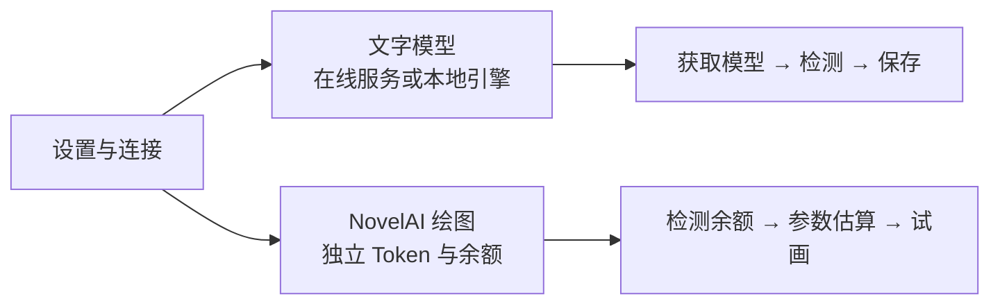
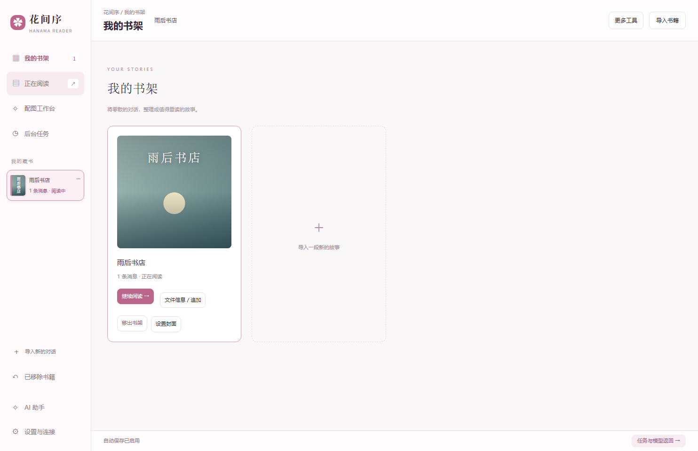
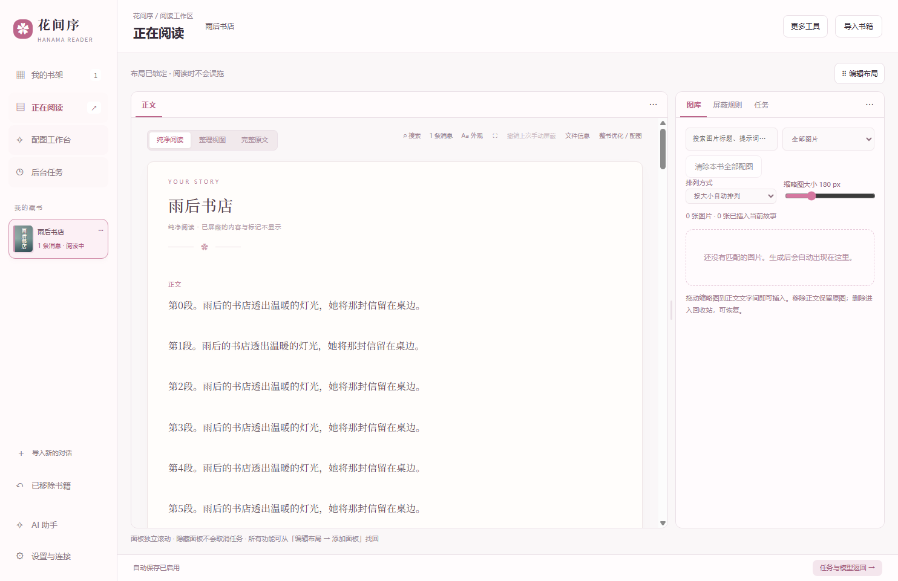
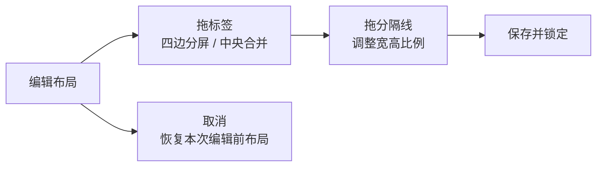
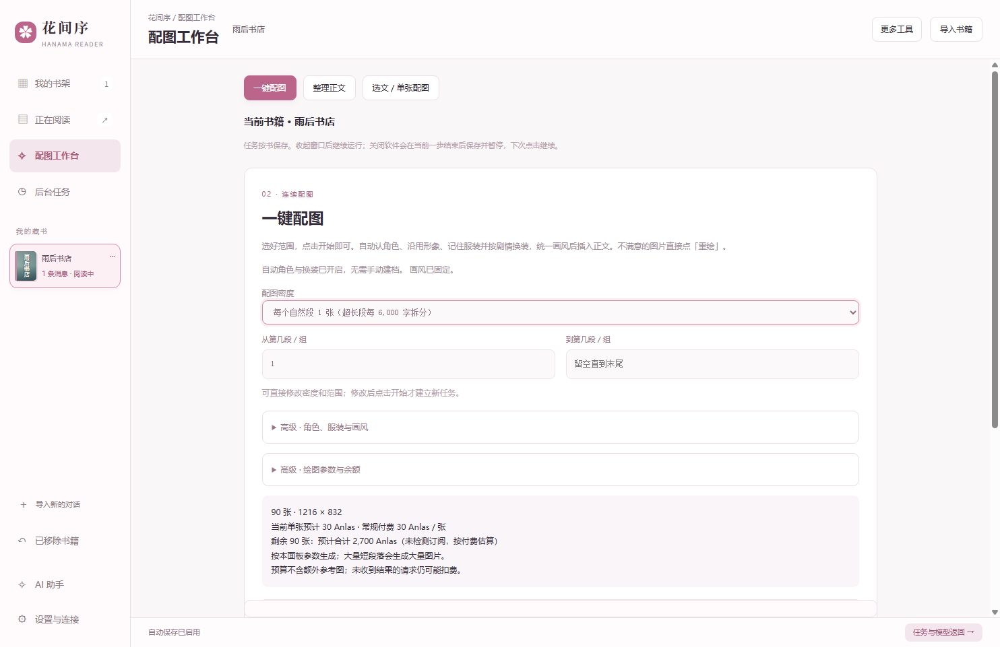
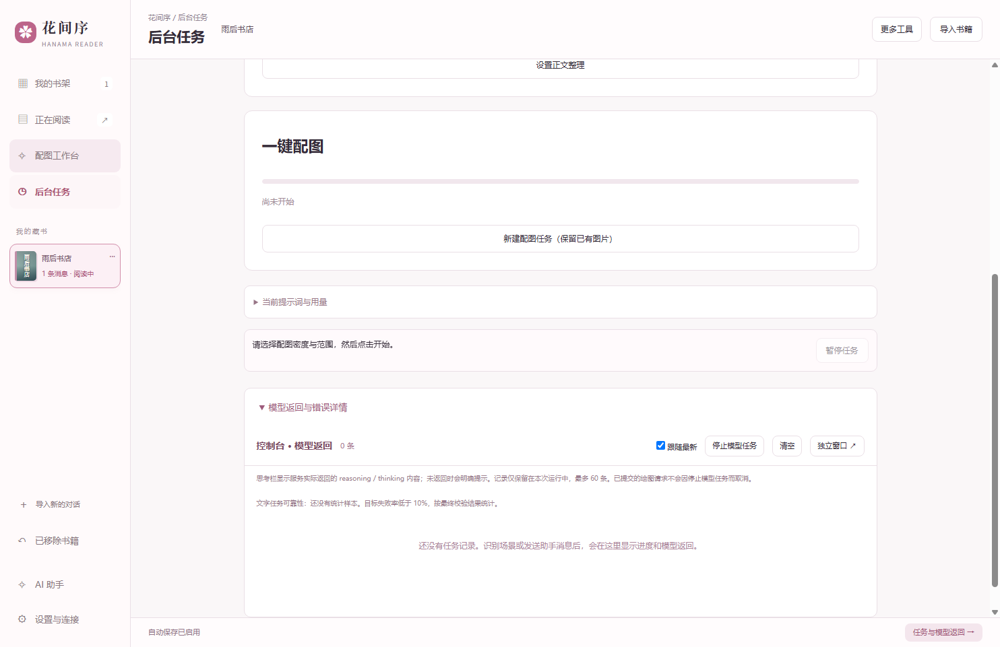
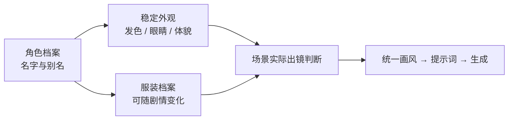

# 花间序完整使用教程

适用源码版本：0.2.0，Windows x64。本文截图来自隔离的教程环境，书名、正文和图片条目均为示例，没有使用真实账号或小说；截图中的未连接、空任务状态是正常的。界面可能随版本小幅变化。

[返回首页](../README.md) · [GitHub 下载与发布](GITHUB_GUIDE.zh-CN.md) · [隐私与备份](PRIVACY.md)

## 目录

1. [安装与首次启动](#安装与首次启动)
2. [连接模型和绘图服务](#连接模型和绘图服务)
3. [导入、合并与书架管理](#导入合并与书架管理)
4. [阅读、搜索与书签](#阅读搜索与书签)
5. [屏蔽、恢复与去重](#屏蔽恢复与去重)
6. [自由组合界面](#自由组合界面)
7. [一键配图与后台任务](#一键配图与后台任务)
8. [选文配图、图库与重绘](#选文配图图库与重绘)
9. [角色、服装与画风](#角色服装与画风)
10. [封面、词库与助手](#封面词库与助手)
11. [保存、导出与更新](#保存导出与更新)
12. [故障排查](#故障排查)

## 安装与首次启动

目前提供源码启动方式，**没有承诺提供安装器，也不能双击 index.html 代替桌面应用**。浏览器打开静态页面不会具备文件、模型与保存功能。

1. 按 [GitHub 教程](GITHUB_GUIDE.zh-CN.md) 下载并解压源码。
2. 安装 Node.js 22.13 或更新的兼容版本。在 PowerShell 执行 `node --version` 与 `npm --version` 确认可用。
3. 准备完整的 Electron **44.4.5 Windows x64** 运行时。优先复用已有版本；不要只复制 electron.exe，旁边的 resources、locales、DLL 等文件也要保留。缺少运行时可从 [Electron 官方 Releases](https://github.com/electron/electron/releases) 获取指定版本；源码启动器不会自动下载。
4. 在源码文件夹内打开 PowerShell，填写你自己的路径：

```powershell
$env:HANAMA_ELECTRON_PATH = 'D:\Tools\electron-44.4.5\electron.exe'
npm run runtime:check
npm start
```

环境变量只对当前终端有效。若希望长期使用，可在 Windows 用户环境变量中添加同名变量，再打开新终端。启动器也识别项目同级 `_shared/runtimes/electron/44.4.5/win32-x64` 和项目内 `node_modules/electron/dist`。

本项目当前没有额外 npm 依赖，不必为了启动再执行 npm install。以后确需安装依赖时，先设置 `$env:ELECTRON_SKIP_BINARY_DOWNLOAD = '1'`，避免重复下载 Electron。保留运行时目录的完整性。

首次启动书架为空，先导入自己的文件。阅读、规则和导出不需要模型密钥；调用在线模型、绘图服务才需要配置。

## 连接模型和绘图服务



### 在线大模型

1. 左下角进入 **设置与连接**，选择在线服务。
2. 填写服务方提供的 OpenAI 兼容 **Base URL**，包括其要求的 `/v1` 等路径。不要把完整 `/chat/completions` 地址当作基础地址。
3. 填 API Key，点击 **保存连接并获取模型**，从列表选择模型。服务不支持列表时填写手动模型 ID；手动值优先，换模型时要一起检查。
4. 点击 **保存并检测模型连接**。成功只说明该次连接和返回正常，不保证所有长文本任务都能完成。
5. 编辑全局提示词并保存。推荐说明语言、风格和任务约束，不要把整本书粘进全局提示词。

密钥框显示“已保存”时，留空会保留原密钥。只有勾选对应的“清除”并保存才移除它。关闭设置可点关闭按钮，也可点击对话框外的空白处。

### 本地 GGUF 模型

软件通过本地推理服务调用模型，**不是直接在阅读器内部运行 GGUF 推理**。先安装并启动兼容的 LM Studio 或 Ollama。优先复用已有模型文件，分片 GGUF 应保留所有分片，不要只移动第一片。

1. 在设置中选择本地模型和已有引擎，检查服务地址。常见默认地址为 LM Studio `http://127.0.0.1:1234/v1`，Ollama `http://127.0.0.1:11434/v1`；以本机实际配置为准。
2. 用本地模型区的硬件检测、文件选择或已有模型列表检查模型。LM Studio 的文件导入、加载能力依赖其本地服务版本；如操作不受支持，先在 LM Studio 中完成导入和加载。
3. 设置上下文长度、GPU 卸载、并行数、保留时间等引擎支持的参数，再加载或连接。模型参数越大、上下文越长，内存与显存占用越高。
4. 设置温度、top-p、最大输出 token、请求超时与任务思考模式。先用短段落检测，再做整书任务；引擎不支持的参数以其提示为准。

“关闭思考”是否有效取决于模型、聊天模板和引擎接口，不代表所有千问模型行为相同。不要仅靠增大输出上限解决上下文不足，输入和输出共用模型上下文预算。

### NovelAI 绘图

1. 在 NovelAI 绘图连接中填写服务地址和自己的 Token。
2. 点击 **保存并检测绘图连接 / 余额**。文字模型和绘图服务是两条独立连接，前者成功不等于后者成功。
3. 在绘图参数中选择模型、宽×高、步数、采样器等，检查费用估算与余额，再生成。

预估费用与实际余额差额不是同一个数：套餐、参数、其他设备消费或充值都会影响结果。余额查询失败应视为未知，不能当作免费。封面测试、画风测试、重绘也会调用绘图服务，可能扣费。

## 导入、合并与书架管理



1. 点击顶部 **导入书籍** 或书架的导入卡片，选择 TXT、JSONL 或支持的 JSON 对话文件。JSONL 适合酒馆导出的记录；JSON 需要消息数组或受支持的 messages/chat 结构。
2. 检查导入预览。发现乱码，切换编码后重新看预览；常见中文旧文本可能采用 GB18030，而非 UTF-8。不要确认已经出现大量 `�` 的预览。
3. 导入多个文件时，先排好顺序，选择新建一本书或追加到已有书。确认前核对书名和目标书。
4. 完全相同文件会按去重逻辑处理；部分重复内容需另行检查候选，不直接凭相似度删正文。
5. 书架或侧栏点击一本书切换。每本书保留自己的规则、插图与阅读位置。

从书籍文件信息入口可查看来源路径、文件信息、追加文件或打开所在目录。移动或删除原文件后，来源定位可能失效，但已导入的本地副本仍可阅读。

**移除**会将书放进“已移除”，可恢复。已移除区域的**永久删除**不可恢复，请先备份。它是管理阅读器内书籍数据的操作，不用于删除原始导入文件。不要把“图库删除”“正文移除插图”“删除整本书”混为一项操作。

## 阅读、搜索与书签



顶部或阅读工具中的视图切换有三种用途：

| 模式 | 用途 |
| --- | --- |
| 纯净阅读 | 屏蔽内容和占位标记都不显示，适合连续阅读。 |
| 整理视图 | 查看被屏蔽区域，展开检查并恢复。 |
| 完整原文 | 对照原始文本，核查整理结果。 |

通过阅读设置调整字体大小、字体颜色、行距等。需要改变一行容纳的字数时，调整正文面板宽度；不是按固定字数截断句子。平时布局锁定，进入编辑布局后才可拖边缘。

**Ctrl+F 搜索**：输入关键词，初次定位参考鼠标所在阅读位置；之后点“下一个”或在搜索框按 Enter，沿当前结果继续查找。鼠标位置是起点，不应把每次 Enter 都重新当作一次搜索。要从新位置开始，可重新发起搜索。搜索词变更会更新结果。

**书签**：选中正文，使用选区工具中的书签操作。阅读滚动区域边缘会出现颜色标记，点击跳到相应位置，正文对应段落也会有区别色。通过书签管理操作修改或移除不需要的标记。

阅读位置会按书保存。切换书、显示或隐藏内容、后台插图完成，都应尽量按原文锚点恢复位置；若原文被合并或修改，位置可能需要重新定位。

## 屏蔽、恢复与去重

### 只隐藏选中的一段

选中正文 → 选区工具 **屏蔽选文**。手动屏蔽保留原始文本。想恢复时切到整理视图，在对应屏蔽区使用恢复操作；纯净阅读中没有隐藏区按钮是正常的。

### 同一段在全文重复出现

选中准确文本 → 使用重复内容屏蔽入口 → 检查匹配次数和候选 → 选择保留首处或处理的范围 → 确认。先确认选区没有带入前后独有的剧情；相似段落不等于完全重复。批量操作完成后可以对照原文，并使用相应撤销入口。

### 起止规则

打开 **更多工具 → 屏蔽规则**，填写起始和结束文本，例如 `<think>` 与 `</think>`，选择是否包含边界，然后应用。它是精确文本区间匹配，不是让模型猜测哪些句子没用。

规则分为通用规则与本书规则；每本书可决定是否启用通用规则。恢复后还看不到正文时，检查是否仍有另一条规则覆盖了同一段。先停用相关规则，再检查手动屏蔽记录。

### 合并后的重复检查

在书籍文件信息中检查重复内容，逐项查看候选及上下文，再确认去重。保留源文件与原文备份，先在较小范围试一次。误操作使用去重撤销；不要把相同人名、重复口头禅或章节标题当作整段重复剧情。

### 大模型整理整书

配图工作台 → **整理正文**，设置范围后开始。软件分批处理，不会把百万字一次塞进模型。模型建议的屏蔽需要能定位到原文；无法可靠定位的项目会报告问题，避免直接删错。到后台任务查看进度、失败原因与重试。模型整理仍可能误判，应在整理视图抽查。

## 自由组合界面



1. 在阅读工作区点击 **编辑布局**。
2. 拖动面板标签到目标区域上、下、左、右，形成分屏；拖到中央合并成标签组。拖到工作区外缘可放在整个工作区的一侧。
3. 也可以点面板 **⋯**，选择“停靠到工作区左侧”等明确方向。
4. 拖动两个面板之间的分隔线调整占比。窗口内悬浮面板可拖标题移动、拖边缘缩放。
5. 点击 **保存并锁定**（以界面实际保存按钮为准）。取消编辑会恢复本次修改前的布局。

窗口内悬浮与独立桌面窗口不同：前者仍在阅读器内，后者可拖到另一个显示器。支持弹出的面板在菜单中有“独立窗口”；置顶控制分别作用于面板或独立窗口。个别任务概览保留在主窗口。隐藏的工具可从更多工具重新打开；布局混乱可用预设或恢复默认。

## 一键配图与后台任务



推荐流程：**连接检测 → 少量试画 → 固定画风 → 设置范围 → 开始 → 后台任务跟踪**。

1. 打开 **配图工作台 → 一键配图**。
2. 选择配图密度，例如每自然段、按分组或指定字数分段。支持的自定义字数范围以输入框限制为准；可尝试 800 或 1000 字，再检查分组数量。
3. 设置从第几段/组到第几段/组。编号依据当前分组方式；修改密度后要重新核对范围。
4. 展开固定画风与测试，填写画风提示词，先生成一张测试图。满意后再开始整书任务。
5. 选择自动角色识别与服装处理方式，设置绘图参数，检查预估消耗。
6. 开始后逐组规划提示词、生成图片并插入该书；进度会保存，不必等整本结束才阅读已有图片。



**后台任务**负责运行控制，**配图工作台**负责新任务设置。失败时在后台任务查看原因，使用“重试并继续”；暂停后继续会沿用原任务参数和进度。修改草稿不等于修改已经运行的任务。如果界面同时显示原任务和新草稿，请明确选择继续原任务或新建任务。

暂停可能要等当前安全边界，不一定能撤回已送达绘图服务器的请求。出现“绘图结果不明”时，先核对图库和服务记录，再确认重试，避免重复扣费。文字规划失败与绘图服务失败是两种不同问题。

模型拒绝某段时可按界面提供的跳过或替代策略处理；这不是保证能绕过模型服务的内容规则。对于不适合直接绘制的内容，跳过通常更稳妥。

生成时可继续阅读、屏蔽、导入和切书；后台任务绑定原书，不应将插图插进刚切换的新书。部分模型和绘图请求会排队执行，不能把可并行操作理解成无限并发绘图。

## 选文配图、图库与重绘

在正文选一段或多段，点选区工具中的 **用于生图**。到场景拆分面板确认范围，按需自动识别多个场景并生成提示词，再选择要画的场景。范围可能是选文、章节或全文，以当前面板范围提示为准；不是每次都自动扫描整本书。

阅读截图右侧为图库，包含筛选、缩略图大小和排列方式。示例库为空；生成后图卡会显示在同一区域。

图库操作：

| 想做什么 | 操作 |
| --- | --- |
| 找图 | 用标题/提示词搜索，选择全部、当前故事、未插入或回收站。 |
| 调整缩略图 | 选择每行张数或按大小自动排列，再拖大小滑杆。固定列数时大小主要影响图片高度。 |
| 插入正文 | 从图库把缩略图拖到文字间；也可用“点选插入”，再点击目标位置。 |
| 改位置 | 拖动已插入的图片到新的文字位置，确认落点。 |
| 看上下文 | 图卡点“定位正文”，跳到该图插入位置；未插入的图会提示。 |
| 移除一张正文插图 | 使用图片菜单/图卡里的正文移除操作，图库原图保留。 |
| 清空本书插图 | 点“清除本书全部配图”，不受图库筛选影响，图库原图保留。 |
| 删除图库图片 | 进入图库回收站，需要时恢复；不要拿它代替正文移除。 |


点击图片或“调整提示词”打开编辑器。可以直接修改正面、负面提示词，也可输入“保留人物，改为傍晚室内”等要求，让当前文字模型提出修改并回填。检查新提示词后再点生成。随机种子用于获得新的构图；要复现结果应同时记录种子、模型和绘图参数。

快速重绘沿用图片已有的角色、服装和画风，使用新的随机种子。编辑窗口关闭不等于取消请求；生成中可以返回阅读，结果和错误到图库/后台任务中查看。重绘是新的服务请求，可能扣费。

## 角色服装与画风



从 **更多工具 → 角色档案** 打开。可手动建立角色，填写名字、别名和形象提示词，先试生成角色图，修改满意后再作为固定设定。也可用扫描全书功能提取候选人物；模型自动识别人名会有误差，需要检查同名、别名和非人物词语。

自动配图可先查已有角色，发现新角色再建立档案。角色的稳定特征（发色、眼睛、体貌）与可变化的服装分开管理：服装档案用于不同阶段或场景的穿着，避免更衣后所有图片仍穿同一套。

远程通话、回忆、意识空间里被提及的角色不一定实际出现在画面。场景规划应依据实际出镜人物选用角色，而不是把全部全局角色拼进每张图。结果奇怪时先检查场景人物和提示词，再修改角色设定。

画风优先在整书任务开始前固定。角色一致性受到模型、提示词、参考图、种子和参数共同影响，不能保证每张图完全相同。对重要角色先做少量试画，定稿后再批量运行。

## 封面词库与助手

### 书本封面

书架截图中每张书卡底部都有“设置封面”。

书架点 **设置封面**，可上传图片、从图库选用或生成候选。填写简介和画风，必要时让文字模型生成封面提示词，再核对分辨率、估算和余额。封面提示词功能只发送填写的简介等内容，不会为此自动发送整书。

候选生成后点击选中，调整书名、作者和文字显示，最后点 **设为封面**。关闭对话框不会自动应用候选。封面与正文插图独立，删正文插图不会等同于清除封面。恢复默认也需要确认应用。

### 本地标签词库


首次发行不附带个人词库或第三方数据库。在词库面板自行导入支持的数据，或使用界面提供的网站同步；获取范围、频率和授权遵守来源要求。导入后用中英文搜索测试，再将标签用于提示词。

在线模型不能自行打开电脑里的 SQLite。软件会从本地词库检索相关条目，把选中的上下文随请求发给模型。不是将整库上传，也不是仅存了数据库模型就自动知道全部标签。标签和模型提示词都应人工核对。

### AI 助手

助手入口位于截图左下角，与设置入口相邻。

左下角打开 AI 助手。设置工作文件夹后，可以要求列文件、导入记录、整理规则或导出。读文件并发送内容、执行外部命令或由助手发起绘图等操作，会按软件流程展示确认。先阅读它准备操作的路径和内容，再决定是否继续。

全新安装的助手文件夹显示“尚未授权”，不会自动创建或授权项目目录。需要时主动选择；用“清除授权”可撤销访问并保存，重新启动后仍未授权，目录里的文件不会被删除。旧版已经保存的授权不会自动丢弃，可自行清除。

授权文件夹不等于给模型整个电脑的任意访问权。不要把包含密码、私人文档的大目录作为演示资料；清空助手对话也不等于清除书籍、图片或账号配置。

## 保存导出与更新

书籍处理、插图和进度会自动保存。留意底部保存状态，关闭前等待保存完成。若磁盘满、权限不足或保存失败，应先处理错误并备份，不要连续强制关闭。

**更多工具 → 导出图文**：当前实现为单文件 HTML，文字和已插入图片内嵌，浏览器可离线打开。导出采用处理后的正文；要留原文请另存原始导入文件。尚未提供正式 EPUB/PDF 导出。生成的 HTML 可能较大，分享前检查其中是否包含私人内容。

更新源码不会替代数据备份。正常关闭应用后备份用户数据目录及独立词库/助手文件夹，步骤见 [隐私与备份](PRIVACY.md)。加密密钥不保证可跨电脑恢复，迁移后可能需要重新输入。不要把备份提交到 GitHub。

## 故障排查

| 表现 | 先做什么 |
| --- | --- |
| 启动找不到 Electron | 运行 runtime:check，核对版本、环境变量及整个解压目录；不必重复安装多份。 |
| Invalid URL | 检查协议、空格、Base URL 和所需路径；不能把 API Key 填到 URL。 |
| 401/403 | 核对密钥、账号权限与服务方限制，文字/绘图分别检测。 |
| 连接关闭、超时 | 查看后台任务原始错误，检查服务/网络；保存进度后重试，不必重跑整书。 |
| 无正文或工具调用 | 本地检查聊天模板、模型兼容性和思考返回格式；在线检查服务原始返回，不要只认为是断网。 |
| 输出上限/上下文不足 | 缩短分段与全局提示词，按模型预算调整输出和上下文；重试失败段，换会话不能增加模型固有容量。 |
| 余额未知、结果不明 | 不要假定免费或失败未扣费；核对服务端记录后再处理。 |
| 密度或范围与预期不符 | 区分新任务草稿和旧任务；旧任务继续使用原设置。 |
| 助手提示尚未授权文件夹 | 这是全新安装的默认状态。到设置中主动选择目录；不使用文件功能时保持未授权即可。 |
| 更新后仍显示旧助手路径 | 更新会保留已有配置。点击“清除授权”撤销，重新启动后仍为空，不会删除原目录。 |
| 导入乱码 | 原文件重新导入，手动选择正确编码；已经替换成乱码的文本不能凭空还原。 |
| 屏蔽后找不到恢复入口 | 切整理视图，检查本书/通用规则及手动屏蔽，不要在纯净阅读中找占位。 |
| 卡顿、白屏 | 暂停任务，记录版本和触发步骤；先用小示例复现。不要直接公开性能文件或整本书。 |
| 图库图片空白 | 检查图片资产是否随数据一起迁移；只复制 story.json 不足以搬走所有图片。 |

需要反馈时按 [GitHub 教程的反馈步骤](GITHUB_GUIDE.zh-CN.md) 提供脱敏错误和最小复现。教程不会承诺模型零误差或自动恢复所有服务错误。
